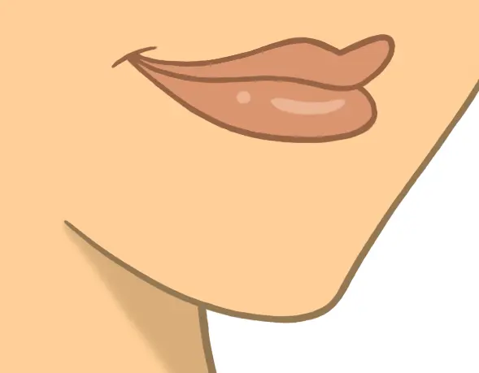
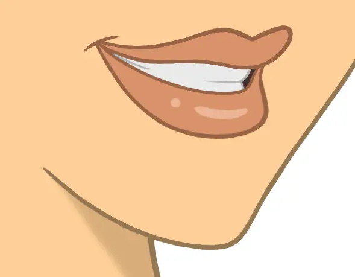
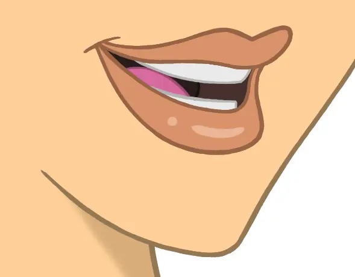
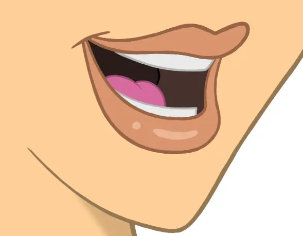
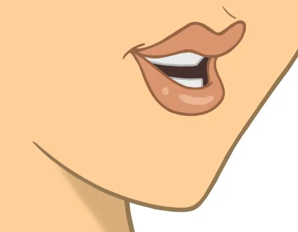
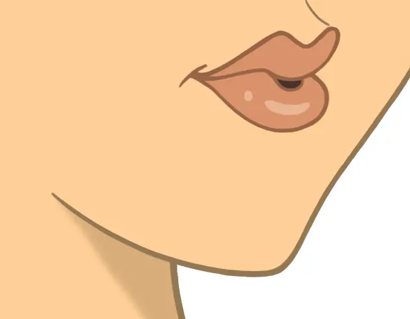
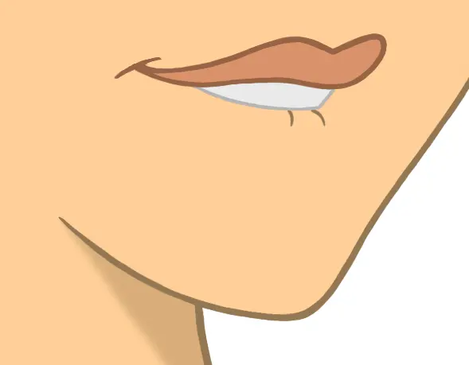
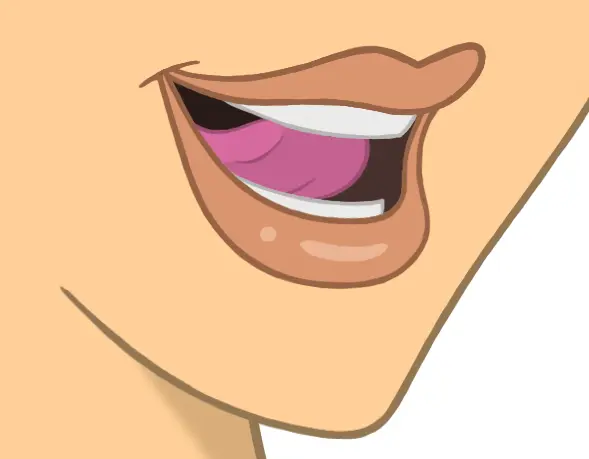
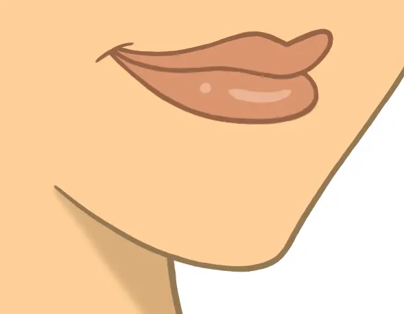

= Mouth shapes
:eleventy-layout: page

Rhubarb Lip Sync can use between six and nine different mouth positions. The first six mouth shapes (*A*-*F*) are the _basic mouth shapes_ and the absolute minimum you need to draw for your character.

In addition to the six basic mouth shapes, there are three _extended mouth shapes_: *G*, *H*, and *X*. These are optional. You may choose to draw all three of them, pick just one or two, or leave them out entirely.

The names of these mouth shapes have nothing to do with the sounds they make. They are simply named alphabetically, starting from *A*.

TIP: The quality of the resulting mouth animation depends a lot on how well your mouth drawing match the descriptions below. For best results, make sure you follow these instructions carefully.

[cols="1h,2,6a"]
|===
3+| Basic mouth shapes

| *A* | 
| Lips closed.

Used for closed-mouth sounds like "`M`", "`B`", "`P`".

| *B* | 
| Lips slightly parted with closed teeth.

Used for many consonants, such as "`K`", "`S`", "`T`", and some vowels such as "`EE`" (b**ee**).

| *C* | 
| Mid-open mouth.

Used for sounds like "`EH`" (b**e**d) and "`AE`" (b**a**t).

IMPORTANT: This shape is also used as an in-between when animating from *A* or *B* to *D*.
So when drawing your mouth images, make sure the animations *A* -> *C* -> *D* and *B* -> *C* -> *D* look smooth!

| *D* | 
| Wide-open mouth.

Used for sounds like "`AH`" (f**a**ther).

| *E* | 
| Slightly rounded lips.

Used for sounds like "`AW`" (s**aw**) and "`ER`" (s**ir**).

[IMPORTANT]
====
This shape is also used as an in-between when animating from *C* or *D* to *F*.
So when drawing your mouth images, make sure the animations *C* -> *E* -> *F* and *D* -> *E* -> *F* look smooth.

In particular, make sure the *E* mouth isn't wider open than *C*, or the transition will look weird.
====

| *F* | 
| Lips rounded and pushed forward.

Used for sounds like "`OO`" (b**oo**t) and "`W`" (**w**ay).

3+| Extended mouth shapes

| *G* | 
| Upper teeth touching the lower lip.

Used for "`F`" (**f**an) and "`V`" (**v**an).

NOTE: This extended mouth shape is optional. If your art style is detailed enough, it greatly improves the overall look of the animation.

| *H* | 
| Tongue raised behind the upper front teeth.

Used for long "`L`" sounds.

IMPORTANT: The mouth should be at least far open as in *C*, but not quite as far as in *D*.

NOTE: This extended mouth shape is optional. Depending on your art style and the angle of the head, the tongue may not be visible at all. In this case, there is no point in drawing this extra shape.

| *X* | 
| Idle position.

Used for pauses in speech. This should be the same mouth drawing you use when your character is walking around without talking. It should be almost identical to *A*, but more relaxed.

NOTE: This extended mouth shape is optional. Whether there should be any visible difference between the rest position *X* and the closed talking mouth *A* depends on your art style and personal taste.
|===

.Consistency between mouth drawings
[TIP]
====
When drawing your mouth images, it's important that each image not only looks good in isolation, but also when quickly switching between mouth drawings.

One trick that can help you is to make sure the upper teeth always stay firm in position. Remember: The upper jaw is fixed to your skull. So if you see the upper teeth move, you know something is wrong.
====
